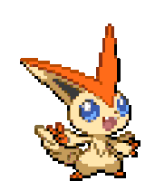

<div align="center">
  
  <br/><br/>
  
</div>

<br/>

I'm a self-taught developer from Brisbane. I started with the web because I wanted to make things people could actually click on, and I've been sliding down the stack ever since. These days it's TypeScript during the day and C at night, mostly so my desktop pet can one day tell you how hot your CPU is running.

I'm finishing a Cert IV in Cyber Security right now, and next year I start Computer Science at QUT. I care way too much about spacing, I name my projects before I build them, and I'd rather ship something rough and fix it than polish something nobody sees.

```
~/jaineel $ cat now.txt

building   →  velo
shipping   →  desktop-buddy for mac
next up    →  a buddy that gets stressed when your pc does
learning   →  C, one segfault at a time
next       →  bachelor of it @ qut, 2027
sora says  →  hi
```

## things I've made

**⭐ [desktop-buddy](https://github.com/jaineeldev/desktop_buddy)** &nbsp;<sub>Electron · React · TS</sub><br/>
A little pet that lives on your desktop. Its face is generated from its name, so no two buddies look the same. It has moods and physics, grabs popcorn when you're watching something, bops along to your music, and dozes off when you leave it alone. The default one is called Sora. It's free on Windows, and the Mac version is nearly here. Next, it learns to read your PC: stressed when things are busy, sleepy when they're quiet. You'll also be able to send your buddy to a friend as a short code. This is the one I'm proudest of.
<br/>
<a href="https://github.com/jaineeldev/desktop_buddy/releases/latest"></a>

<p align="center">
  <picture>
    <source media="(prefers-color-scheme: dark)" srcset="./assets/desktop-buddy-dark.gif" />
    <source media="(prefers-color-scheme: light)" srcset="./assets/desktop-buddy-light.gif" />
    
  </picture>
</p>


**velo** &nbsp;<sub>Next.js · TS · Postgres · Stripe</sub><br/>
Proposals, approvals, milestones and invoices in one place instead of seven email threads. Built for Australian freelance devs and agencies, and heading for a waitlist launch. <sub>`in development`</sub>

**[jaineel.dev](https://jaineel.dev)** &nbsp;<sub>Next.js · Tailwind · Framer Motion</sub><br/>
My corner of the internet. One blue, two typefaces, too many hours on spacing.

**[hawthornecornerstore.com.au](https://www.hawthornecornerstore.com.au)** &nbsp;<sub>React · Vite</sub><br/>
A site for a local corner store. Real client, real deadline, real feedback.

**[system-fingerprint-tool](https://github.com/jaineeldev/system-fingerprint-tool)** &nbsp;<sub>Python</sub><br/>
A GUI that tells you what a machine is and which ports it left open.

**[c-learning](https://github.com/jaineeldev/c-learning)** &nbsp;<sub>C</sub><br/>
Me vs. pointers. Ongoing.

**[cybersecurity-assessments](https://github.com/jaineeldev/cybersecurity-assessments)**<br/>
The paperwork side of security: legislation, policy and process. Less flashy, still matters.

## how I got here

```
~/jaineel $ git log --oneline --reverse

a1f3c02  taught myself html to make ____
b7e9d41  first real client site: hawthorne corner store
c2d8e10  cert iv in cyber security, tafe qld
d4f1a77  desktop-buddy hits 1.0
e9b3c55  bachelor of it @ qut  (2027, pending)
```

## my setup

```
os         →  windows 11
editor     →  visual studio code
pairing    →  claude code
go-to      →  next.js · typescript · tailwind · shadcn/ui
data       →  neon postgres
ships to   →  vercel · cloudflare
```

## what I reach for


<details>
<summary><sub>the numbers, if you're into that</sub></summary>
<br/>
<p align="center">
  
  
</p>
</details>

<p align="center">
  
</p>

## say hi

[jaineel.dev](https://jaineel.dev) &nbsp;·&nbsp; [linkedin](https://www.linkedin.com/in/jaineel-khatri/) &nbsp;·&nbsp; [jaineelk.dev@gmail.com](mailto:jaineelk.dev@gmail.com) &nbsp;·&nbsp; [ko-fi](https://ko-fi.com/jaineeldev)

<div align="center">
  <br/>
  <sub>you made it to the bottom. sora says hi.</sub>
</div>
